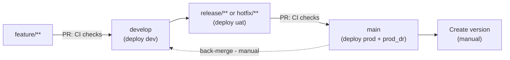

# Azure Data Factory Repository


## FlexboxCgGhaAdf

Azure Data Factory project generated with GitHub Actions CI/CD. Add Data Factory resources as JSON under `linkedservice/`, `dataset/`, `pipeline/`, and `trigger/` at the repository root. A sample pipeline (`pipeline/pipeline.json`) is included and deployed on the first run.

## Generated configuration

- Project name: `FlexboxCgGhaAdf`
- Project environments: `dev,uat,prod`
- GitHub administrators team: `flexbox-cg-gha-adf-admins`
- GitHub developers team: `flexbox-cg-gha-adf-developers`

`CODEOWNERS` uses the configured team values.

## Repository structure

```
FlexboxCgGhaAdf/
|-- .github/
|   |-- scripts/
|   |   `-- New-DataFactoryDeploy.ps1   # Az.DataFactory deployment script run by CD
|   `-- workflows/                      # CI/CD workflows
|-- linkedservice/                      # Linked services (only files named local* are deployed)
|-- dataset/                            # Datasets
|-- pipeline/                           # Pipelines (ExecutePipeline references resolved recursively)
|   `-- pipeline.json                   # Example pipeline
|-- trigger/                            # Triggers (BlobEventsTrigger is not supported)
|-- .pre-commit-config.yaml
|-- CODEOWNERS
`-- README.md
```

## CI/CD integration

- GitHub Environments: `dev`, `uat`, `prod`, and `prod_dr` (created for provisioned environments; `prod_dr` is always created)
- Deployment runner: organization runner group `devx-pgi` (`devx-pgi-dr` for `prod_dr`) with label `pg-pgi-4gb-1cpu`
- Shared actions: `procter-gamble/da-pp-pda-github-actions`
- Authentication: GitHub OIDC without an Azure client secret

Repository variables control automatic deployments. Workflows are generated for `dev,uat,prod` regardless of which environments exist today; `CICD_DEPLOY_<ENV>_ENABLED` is `true` only for provisioned environments.

### Repository variables

- `AZURE_TENANT_ID`: Entra tenant shared by all environments
- `CICD_DEPLOY_DEV_ENABLED`: development deployment
- `CICD_DEPLOY_UAT_ENABLED`: UAT deployment
- `CICD_DEPLOY_PROD_ENABLED`: production deployment
- `CICD_DEPLOY_PROD_DR_ENABLED`: production DR deployment
- `SONAR_PROJECT_KEY`: SonarQube project key for the scan

Only the exact lowercase value `true` enables a deployment.

### Environment variables

- `AZURE_CLIENT_ID`: client ID of the Entra ID application used by that environment
- `AZURE_SUBSCRIPTION_ID`: Azure subscription ID used for OIDC login
- `RESOURCE_GROUP`: resource group containing the Data Factory
- `DATA_FACTORY_NAME`: target Azure Data Factory name

### Secrets

- `SONAR_TOKEN`: SonarQube authentication token

### Federated credentials

Each environment uses a federated credential provisioned on its client service principal. The GitHub environment selects the corresponding `AZURE_CLIENT_ID`, subscription, resource group, and Data Factory values. The authentication configuration is ready to use after provisioning.

Federated credential subject examples:

- Environment: `repo:ORGANIZATION/REPOSITORY:environment:dev`
- Branch: `repo:ORGANIZATION/REPOSITORY:ref:refs/heads/develop`
- Immutable environment: `repo:ORGANIZATION@ORGANIZATION_ID/REPOSITORY@REPOSITORY_ID:environment:dev`

## Code analysis

CI runs a SonarQube scan on every build over the Data Factory JSON definitions. The scan reports issues and duplication, but no test coverage: the repository holds configuration rather than executable code, and the workflow does not run tests.

If the project later adds testable code, edit the `build` job in `.github/workflows/ci-tasks.yml`:

1. Add a test step between the `Upload artifact` and `SonarQube scan` steps, so the report exists before the scan reads it.
2. Add the coverage property for your test tool to the `args` block of the `SonarQube scan` step, for example:

```
-Dsonar.python.coverage.reportPaths=coverage.xml
-Dsonar.tests=tests
```

The property name depends on the language (`sonar.python.coverage.reportPaths`, `sonar.javascript.lcov.reportPaths`, `sonar.coverage.jacoco.xmlReportPaths`). Coverage only appears in SonarQube when the report is written before the scan runs and the path matches the file the test tool actually produced.

## Workflow behavior

- `Pull Request Checks` (`ci-pull-requests.yml`): validates and packages pull requests to `main` or `develop`
- `Continuous Delivery` (`cd.yml`): runs validation and packaging once, then deploys only the enabled environments selected for the pushed branch
- `Reusable Validation and Build` (`ci-tasks.yml`): callable workflow used by pull request checks and continuous delivery; it does not run independently
- `Version Tagging` (`util-release-tag.yml`): manually calculates the next version and creates a Git tag and GitHub release; it does not deploy application code

Deployment routing after a successful artifact build:

- Push to `develop`: deploy to `dev` when enabled
- Push to `release/**` or `hotfix/**`: deploy to `uat` when enabled
- Push to `main`: deploy to `prod` and `prod_dr` independently when enabled; both run in parallel

The repository should ideally follow GitFlow: develop features through `feature/**` branches, integrate them into `develop`, stabilize releases through `release/**` or `hotfix/**`, and merge production-ready changes into `main`. Back-merge changes from `main` into `develop` after production or hotfix merges.

### Commit lifecycle

Each push triggers a deployment based on the branch. Pull requests to `develop` or `main` run CI checks. Creating a version is a separate manual step, and a back-merge from `main` into `develop` keeps the branches aligned.



- Merging into `develop` deploys `dev`; pushing `release/**` or `hotfix/**` deploys `uat`; merging into `main` deploys `prod` and `prod_dr` in parallel (each only when its variable is enabled).
- Versioning is manual: `util-release-tag.yml` calculates the next version and creates the tag and release. It does not deploy application code.
- After a production or hotfix merge, back-merge `main` into `develop` so both branches stay in sync.

### Deployment mechanism

CD downloads the packaged source, establishes an Azure PowerShell context through OIDC, and runs `.github/scripts/New-DataFactoryDeploy.ps1`. The script deploys linked services (only files named `local*`, Azure Key Vault services first), datasets, pipelines (resolving `ExecutePipeline` references recursively), and triggers (stopped before deployment and started on production when their runtime state is `Started`).

CI stores `app-RUN_ID-COMMIT_SHA.zip` for 14 days in `artifact-RUN_ID-COMMIT_SHA`.

`GitVersion.yml` uses Git history. On `main`, it uses `ContinuousDeployment`, increments `Minor`, and ignores version directives in commit messages.

## Maintenance

Actions are pinned to commit SHAs for reproducibility and supply-chain security. Update pins through a reviewed pull request and test CI/CD. Template updates are not synchronized automatically.

Local validation:

`pre-commit run --all-files`

For skipped or queued deployments, check the deployment variable and the `pg-pgi-4gb-1cpu` runners in the `devx-pgi` group (`devx-pgi-dr` for `prod_dr`). For Azure failures, check environment values, the OIDC subject, resource names, and Azure permissions.